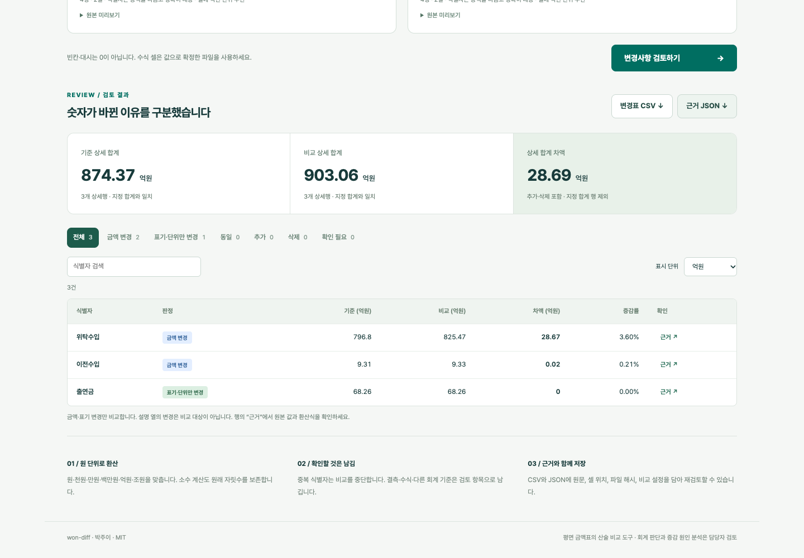

# won-diff — 한국어 예산표 변경 검토

[](https://github.com/parkjui92/won-diff/actions/workflows/verify-deploy.yml)

**1,000백만원 → 10억원. 숫자는 달라졌지만 금액은 같습니다.**

won-diff는 두 표의 항목을 식별자로 맞추고, 원화 단위를 통일해 **실제 금액 변경 / 표기만 변경 / 추가·삭제 / 확인 필요**를 구분합니다. 원래 값과 셀 위치, 환산식, 파일 해시를 남깁니다. 정책기획·사업관리에서 예산표를 전년 자료나 수정본과 대조할 때 쓰는 개인 개발 도구입니다.

**[바로 실행](https://parkjui92.github.io/won-diff/) · [한국어 설명 영상](https://parkjui92.github.io/won-diff/demo.html) · [오프라인 파일 다운로드](https://github.com/parkjui92/won-diff/releases/latest/download/won-diff.html)**

[](https://parkjui92.github.io/won-diff/demo.html)

영상은 실제 프로그램을 조작해 녹화했습니다. 공개 KIAT 표 비교, 단위 환산 근거, 회계 기준 경고, 중복 키 차단, 결과 저장을 설명합니다. 한국어 음성은 합성 음성이며, 화면 자막과 전체 대본을 제공합니다. **[MP4 직접 보기](docs/assets/demo-ko.mp4) · [영상 대본](docs/VIDEO.md)**

## 어떻게 쓰나

1. **기준 파일과 비교 파일**을 선택합니다. CSV·TSV·XLSX를 지원합니다.
2. 시트와 제목 행을 고르고, **식별 열·금액 열·단위·회계 기준·시점**을 지정합니다. 같은 항목이 여러 번 나오면 두 번째 식별 열을 추가합니다.
3. 평면 표에 합계 행이 있으면 그 행을 지정합니다. 해당 행은 상세 합산에서 빼고 검산에 사용합니다.
4. **변경사항 검토하기**를 누릅니다. 필터와 검색으로 항목을 좁히고, **근거**에서 원문 셀과 환산식을 봅니다.
5. **변경표 CSV / 근거 JSON**을 저장합니다.

엑셀의 `100`만으로는 원인지 백만원인지 알 수 없습니다. 열 단위는 사용자가 확인합니다. 셀에 `10억원`처럼 단위가 적혀 있으면 그 단위가 우선합니다. 식별자는 정확히 일치시킵니다. 사업명이 바뀌면 임의로 같은 사업이라고 추측하지 않습니다.

## 실제로 검증한 이점

범용 표 비교 도구인 [daff](https://github.com/paulfitz/daff), [csv-diff](https://github.com/simonw/csv-diff), [TabularDelta](https://github.com/Quantco/tabulardelta)를 직접 실행해 비교했습니다.

**직접 설계한 원화 표현 24쌍**을 “실제 금액이 바뀌었는가”로 판정한 결과입니다. 실제 변경 12쌍, 금액 동일 12쌍이며, 동일한 12쌍 중 10쌍은 표기가 다릅니다.

| 입력 조건 | won-diff | daff 1.4.2 | csv-diff 1.2 | TabularDelta 1.1.1 |
|---|---:|---:|---:|---:|
| 원래 표현 그대로: 실제 변경 12건 탐지 | 12 | 12 | 12 | 12 |
| 원래 표현 그대로: 동일 금액을 변경으로 표시한 건수 | **0** | 10 | 10 | 10 |
| 독립적으로 원 단위 전처리한 뒤: 올바른 판정 | 24/24¹ | 24/24 | 24/24 | 24/24 |

¹ won-diff의 원래 표현 입력 결과. 범용 도구에는 별도로 작성한 정규화 값을 넣어 대조했습니다.

범용 도구가 문자열 차이를 표시한 것은 그 도구의 오류가 아닙니다. **won-diff의 이점은 한국어 원화 환산과 검토 근거 정리를 사용자가 따로 구현하지 않아도 된다는 점**입니다. 전처리를 붙이면 기존 도구도 같은 결과를 냅니다. 이 소규모 설계 사례로 모든 데이터의 정확도나 일반적 우월성을 주장하지 않습니다.

[전체 비교 검토](docs/COMPARISON.md) · [입력·정답](benchmarks/cases.json) · [실행 결과](benchmarks/results.json) · [재현 코드](benchmarks/run.ts)

## KIAT 공개자료 검증

[ALIO의 KIAT 2025년 1분기 수입·지출 공시](https://alio.go.kr/upload/disclosure/2025/04/10/2025041002977191/doc.html)에서 정부지원수입의 출연금·이전수입·위탁수입과 소계를 발췌했습니다.

| 확인한 조건 | 결과 |
|---|---|
| 2023·2024 결산 비교, 2024년만 억원으로 환산 | 실제 변경 2건, 단위·표기만 변경 1건 |
| 두 연도 상세 합계 차이 | **28.69억원**, 원문 소계와 일치 |
| 동일한 2024년 표의 백만원·억원 사본 비교 | 실제 변경 0건 |
| 2024 결산과 2025 예산 비교 | 회계 기준 경고, 증감률 미산출 |
| 합계에 일부러 1백만원을 더한 합성 오류 | 합계 불일치 탐지 |

공시는 과년도 결산을 발생주의, 당해연도 예산을 현금주의로 작성한다고 명시합니다. 마지막 오류 실험은 개발자가 만든 변형이며 **KIAT 공시에 오류가 있다는 뜻이 아닙니다**. 수치가 있는 3개 항목의 발췌 검증으로, 전체 기관 회계 감사가 아닙니다.

[출처·가공 과정·한계](docs/DATA.md) · [공개 입력 파일](examples/) · [자동 검증](tests/public-data.test.ts)

## 검토를 멈추거나 남기는 조건

- **중복·빈 식별자, 중복 헤더, 잘못된 열 지정:** 비교 중단.
- **빈칸·대시·비공개:** 0으로 바꾸지 않음. 확인된 금액의 소계만 제시하며 전체 차액은 미확정.
- **수식 셀:** 저장된 캐시값을 확정 금액으로 쓰지 않음. Excel에서 값으로 확정한 사본으로 비교.
- **합계 불일치:** 차이와 위치를 제시. 공시 반올림이나 범위 차이까지 자동으로 오류라고 단정하지 않음.
- **회계 기준 다름·미확인:** 산술 차액은 표시하되 증감률 미산출.
- **기준 금액 0 이하:** 증감률 미산출.
- **병합·계층표:** 헤더와 데이터 영역의 병합 셀은 거부. 소계·합계가 겹치지 않는 평면 표로 정리.

## 로컬 실행과 CLI

웹 페이지는 파일을 서버에 보내지 않습니다. API 키·계정·LLM이 필요 없고, 파일을 브라우저 저장소에도 자동 저장하지 않습니다. **오프라인 HTML 한 파일**을 내려받아 더블클릭하면 네트워크 없이 XLSX도 처리합니다. 웹 호스팅 접속 기록은 GitHub Pages의 일반적인 정적 파일 요청이며 입력 파일 내용은 포함되지 않습니다.

개발 환경은 Node.js 22.12 이상입니다.

```bash
git clone https://github.com/parkjui92/won-diff.git
cd won-diff
npm ci
npm run dev
```

CLI는 웹과 동일한 계산 코드를 씁니다.

```bash
npm run build
node dist-cli/cli.mjs examples/kiat-2023-백만원.csv examples/kiat-2024-억원.csv \
  --config examples/mapping.json \
  --out review.json --csv changes.csv
```

설정 예:

```json
{
  "before": {
    "keys": ["사업코드"], "amount": "금액", "unit": "백만원",
    "basis": "settlement", "period": "2023 결산"
  },
  "after": {
    "keys": ["사업코드"], "amount": "금액", "unit": "억원",
    "basis": "settlement", "period": "2024 결산"
  }
}
```

각 설정에 `sheet`, `headerRow`, `encoding`(`utf-8`/`euc-kr`), `totalKey`(식별 열 순서의 배열)를 추가할 수 있습니다. `basis`는 `budget`·`settlement`·`proposal`·`other`·`unknown`입니다. `other`와 `unknown`은 비교 가능성이 확인되지 않은 것으로 처리합니다.

CLI 종료 코드: `0` 성공, `1` 입력 오류, `2` `--fail-on-change`를 지정했을 때 실제 변경·추가·삭제 발견, `3` 확인할 사항 발견. 입력 오류와 확인 필요가 변경 코드보다 우선합니다. 기존 출력 파일도 덮어쓰지 않으므로 다시 실행할 때 새 이름을 지정하세요.

## 검증과 재현

```bash
npm test                  # 단위·통합·무작위 불변식·CLI·공개자료
npm run build             # 웹 + CLI + 오프라인 HTML
npm exec vite preview -- --port 4173  # 다른 터미널에서 아래 실행
npm run test:e2e           # 로컬 Chrome, CI에서는 Playwright Chromium
```

비교 실험:

```bash
python3 -m venv .venv
.venv/bin/pip install -r benchmarks/requirements.txt
npm run bench
```

83개 자동 테스트에는 고정 시드의 무작위 입력 1,200회가 포함됩니다. 브라우저 검증은 실제 파일 업로드, 다운로드, 입력 변경 후 결과 무효화, 중복 키, 수식, HTML 주입 문자열, 모바일·키보드, 네트워크 차단 상태의 오프라인 XLSX 처리를 다룹니다. [검증 기록](docs/VALIDATION.md)에서 실행 조건과 한계를 확인할 수 있습니다.

## 지원 범위

- 파일당 5MB, 데이터 10,000행, 100열. XLSX의 선언된 압축 해제 크기 40MB·내부 파일 2,000개 상한.
- 원·천원·만원·백만원·억원·조원, 쉼표, 최대 6자리 소수, 음수, 복합 단위 표현. 최대 30자리 숫자 입력.
- 금액은 `decimal.js` 80자리 정밀도로 계산. 증감률만 소수점 둘째 자리 반올림.
- CSV의 셀 주소는 인용문 안의 줄바꿈을 한 행으로 센 **논리 레코드 번호**. XLSX는 시트명과 셀 주소.
- 통화는 원화만 지원. 환율, 물가 조정, 회계 기준 변환은 수행하지 않음.
- PDF/HWP OCR, 구형 XLS, 사업명 의미 매칭, 임의 계층표 자동 해석, 수식 재계산, 사업별 증감 원인·성과 판정은 범위 밖.
- Excel에 숫자로 저장한 긴 식별자는 이미 선행 0 등이 손실됐을 수 있음. 식별자는 텍스트 셀 사용 권장.
- 안전한 정수 범위를 넘는 Excel 숫자 금액은 판정을 보류. Excel에서 이미 반올림한 값을 복원하지 않으므로 긴 금액은 원천값을 확인해 텍스트로 입력. CSV를 Excel로 열 때도 긴 숫자의 자동 변환에 주의하고, 정확한 기계 판독에는 JSON 사용.
- `△`는 회계 문서의 음수 표기로 처리. `▲`는 증가·감소 의미가 문서마다 달라 추측하지 않고 확인 필요로 처리.

기존 [kr-sti-data](https://github.com/parkjui92/kr-sti-data)는 자료 수집, [rnd-eval-skills](https://github.com/parkjui92/rnd-eval-skills)는 평가 절차, won-diff는 **해석 전 금액표 검산**을 맡습니다.

## 문서와 라이선스

[개발 계획](docs/PLAN.md) · [비교 검토](docs/COMPARISON.md) · [데이터 근거](docs/DATA.md) · [검증 기록](docs/VALIDATION.md) · [변경 이력](CHANGELOG.md)

박주이 · MIT. 공개 원천 자료의 사실값을 출처와 함께 발췌했으며, 기관 로고·내부 자료·연락처를 배포하지 않습니다. 의존 라이브러리의 라이선스는 [THIRD_PARTY.md](THIRD_PARTY.md)를 참고하세요.
